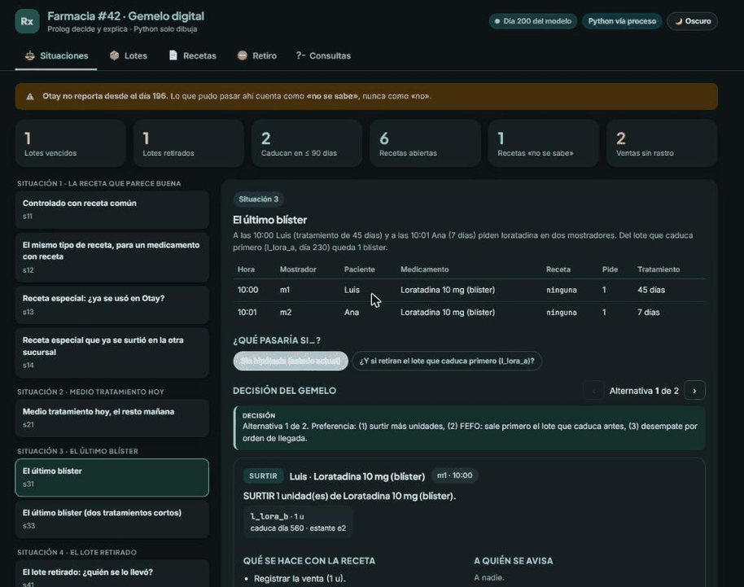
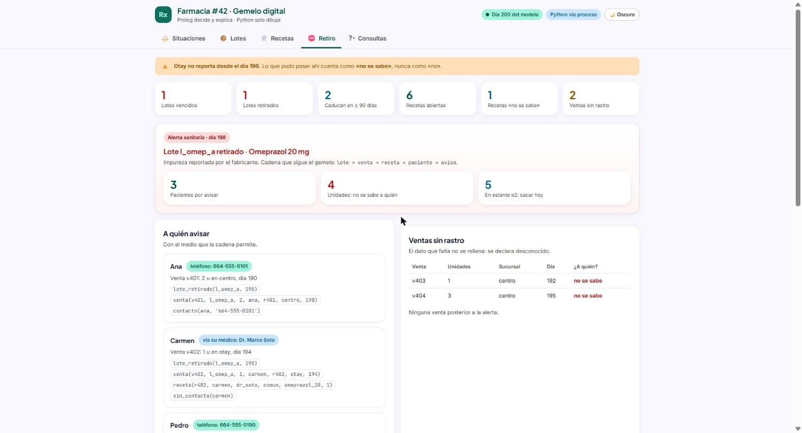
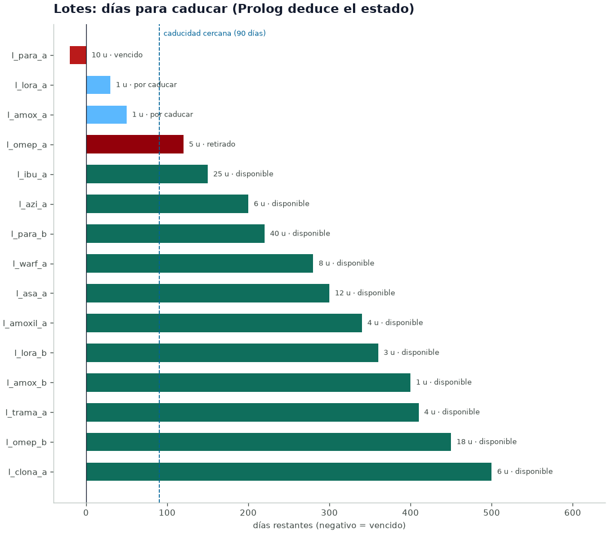

# #42 Farmacia — Gemelo digital en SWI-Prolog (con Python vía Janus)

**Hugo Iram Aguirre Dávila** · ISC · TecNM Tijuana · Programación Lógica y Funcional (26b, 4A)
Proyecto final 3.3: *«En Prolog con Python/Janus elabore la EXTENSIÓN de su proyecto original»*.
El reto está en [`PROBLEMA.md`](PROBLEMA.md); el contexto y el contrato, en [`CONTEXTO_AGENTES.md`](CONTEXTO_AGENTES.md).
Ejercicio con datos simulados: **no es un sistema de dispensación real**.

> En Erlang la farmacia **hace** cosas: procesos que no sobrevenden el último blíster y se recuperan si mueren.
> En Prolog el gemelo **deduce**: ¿le surto esto a esta persona, de qué lote, y por qué? ¿Y si no sé?



🎬 Video de demostración con subtítulos (1 min 53 s): [`capturas/demo-gemelo.mp4`](capturas/demo-gemelo.mp4)

## Cómo correrlo

```bash
cd gemelo
swipl -g run_tests -t halt tests/reglas_tests.pl   # 34 pruebas plunit, todas en verde
swipl servidor.pl                                   # http://localhost:8042/
swipl gemelo.pl                                     # consola: ?- decide_escenario(s31, ninguna, A, D, E).
```

| Entorno | Qué se necesita | Python |
|---|---|---|
| Windows (probado: SWI-Prolog 11.0.1 + Python 3.11) | SWI-Prolog y `pip install matplotlib` | Prolog lanza `python graficas.py` como proceso (este SWI-Prolog para Windows no trae `library(janus)`) |
| Ubuntu 24.04 / WSL / EC2 (AWS Academy) | `bash instalar_ubuntu.sh` (PPA de SWI-Prolog + `python3-matplotlib`) | **Janus**: `py_call/2` en el mismo proceso, como en `logicDemo2` |
| Docker | `docker build -t gemelo42 . && docker run -p 8042:8042 gemelo42` | Janus |

`graficas.pl` elige el camino solo (`:- if(exists_source(library(janus)))`) y la página muestra cuál se usa
(«Python vía Janus» / «Python vía proceso»). En los dos casos **Prolog decide y Python solo dibuja**.
En EC2 hay que abrir el puerto 8042 en el grupo de seguridad.
Probado en los dos caminos:
- **Windows** (esta laptop): SWI-Prolog 11.0.1 + Python 3.11, modo proceso, 34/34 pruebas.
- **Ubuntu 24.04 con Janus** en GitHub Actions ([`.github/workflows/gemelo.yml`](../.github/workflows/gemelo.yml)):
  `py_call(sys:version, V)` responde Python 3.12.3, 34/34 pruebas, gráficas con `modo_python = janus`,
  el gemelo mínimo de la práctica y el servidor web respondiendo
  ([captura](capturas/12-ci-ubuntu-janus.jpg), [ejecuciones](https://github.com/Juicyss/42-farmacia/actions)).

## Arquitectura

```
web/ (HTML+CSS+JS)  ──GET /api/*──▶  servidor.pl  (library(http): JSON y archivos estáticos)
   solo pregunta y muestra              │
                                        ├── hechos.pl      estado de la farmacia (todo dinámico)
                                        ├── reglas.pl      decide/3-4, situacion/3, que_falta/2, hipotesis/2, retiro/2
                                        ├── escenarios.pl  las 5 situaciones como solicitudes de mostrador + hipótesis
                                        └── graficas.pl ──py_call (Janus) / proceso──▶ graficas.py (matplotlib)
tests/reglas_tests.pl  34 pruebas plunit (al menos una por situación y por criterio)
```

| Archivo | Qué hay |
|---|---|
| [`hechos.pl`](hechos.pl) | 2 sucursales, 4 mostradores, 11 medicamentos, 15 lotes, 4 pacientes, 2 médicos, 10 recetas, ventas, devoluciones, alerta sanitaria. `ahora(200)` es un hecho. |
| [`reglas.pl`](reglas.pl) | Condiciones de tres valores, reparto de lotes por *backtracking*, costo (FEFO + desempate), explicación, «qué falta», hipótesis, retiro de lote, `situacion/3`. |
| [`escenarios.pl`](escenarios.pl) | Las solicitudes de cada situación y 5 hipótesis «¿qué pasaría si…?». |
| [`servidor.pl`](servidor.pl) | Rutas `/api/estado`, `/api/existencias`, `/api/recetas`, `/api/escenarios`, `/api/decide`, `/api/retiro`, `/api/que_falta`, `/api/situaciones` y `/grafica/*`. |
| [`graficas.pl`](graficas.pl) · [`graficas.py`](graficas.py) | Prolog arma las listas; Python dibuja caducidades, recetas y el destino del lote retirado. |
| [`web/`](web/) | Interfaz con el sistema de diseño de Stitch «Clinical Precision» (claro y oscuro, móvil). Ninguna regla vive aquí. |
| [`design/`](design/) | `DESIGN.md` y pantallas exportadas de Stitch + el prompt de las pantallas del gemelo. |

## El contrato

| Predicado | Para qué |
|---|---|
| `decide(+Solicitudes, -Decision, -Explicacion)` | Reparto completo para una **lista** de solicitudes. Con `;` da las demás alternativas válidas, de la mejor a la peor. Nunca falla en silencio: si nada se surte, el veredicto dice por qué. |
| `decide(+Sols, alternativa(N, Total), -D, -E)` | La alternativa N de Total. |
| `situacion(?Entidad, ?Situacion, -Evidencia)` | Lotes (vencido, retirado, por caducar…), recetas (válida, inválida, dudosa, usada, cerrada, abierta), ventas sin rastro, riesgo de interacción, alergia en receta, alergias desconocidas, pacientes por avisar, sucursal sin reporte. En cualquier dirección. |
| `que_falta(+Solicitud, -Faltas)` · `que_falta_receta(+R, -F)` | La pregunta al revés: qué condición no se cumple o no se sabe y qué hacer. |
| `hipotesis(+Cambios, :Meta)` | Aplica `[+Hecho, -Hecho]`, resuelve `Meta` con las mismas reglas y lo deshace todo. |
| `retiro(+Lote, -Informe)` | Avisos por la cadena lote → venta → receta → paciente, ventas sin rastro, unidades en estante, devoluciones. |

Una solicitud es `sol(Id, Mostrador, Paciente, Receta, Med, Cantidad, DiasTratamiento, Instante)`.
`Decision = [r(Id, Veredicto, Entregas, AccionesReceta, Avisos)]` con
`Veredicto ∈ surtir(K) | surtir_parcial(K, Objetivo) | rechazar(Motivos) | suspender(Motivos)`.
`Explicacion = [porque(Id, Tipo, Texto, Hechos)]`, `Tipo ∈ decision | bloqueo | duda | dilema | contraintuitivo | lote | advertencia | apoyo`.

**Tres valores siempre.** Cada condición vale `si`, `no` o `no_se`. Un dato ausente (alergias no capturadas,
sucursal sin reporte, cliente anónimo) nunca cuenta como «no». Qué incertidumbres **detienen** el surtido
(`suspender`) y cuáles solo advierten está en una sola regla, `duda_bloquea/2`.

## Las cinco situaciones

| # | Escenario | Qué decide el gemelo | Captura |
|---|---|---|---|
| 1 | `s11` Luis, clonazepam con receta **común** | **Rechazar**: un controlado exige receta especial. Lo intuitivo («trae receta firmada») está mal. | |
| 1 | `s12` Carmen, azitromicina con receta común | **Surtir**, sellar y **retener** (antibiótico, se completa lo prescrito). Mismo tipo de receta, otro requisito. | |
| 1 | `s13` Luis, receta **especial** con folio | **Suspender · no se sabe**: Otay no reporta desde el día 196. «No sé si se usó» ≠ «no se usó». Hipótesis «Otay reporta» → surtir, retener y asentar en el libro de control. | [03](capturas/03-s1-no-se-sabe.jpg) · [04](capturas/04-s1-hipotesis-otay.jpg) |
| 1 | `s14` Ana, receta especial ya surtida en Otay | **Rechazar** y avisar al responsable sanitario. | |
| 2 | `s21` Carmen, 4 cajas de amoxicilina (1 ya surtida), hay 2 | **Surtido parcial 2 de 3**, sellar y devolver la receta (no retener). Nombra quién pierde en el dilema. Hipótesis «llega un lote» → completa y retiene. | [05](capturas/05-s2-dilema-surtido-parcial.jpg) |
| 3 | `s31` El último blíster: Luis (45 días, llegó primero) y Ana (7 días) | **Contraintuitivo**: Luis recibe `l_lora_b`, Ana el último blíster de `l_lora_a` (caduca el día 230; el tratamiento de Luis terminaría el 245). Alternativa 2 válida pero peor (no FEFO). | [01](capturas/01-s3-ultimo-blister.jpg) · [02](capturas/02-s3-contraintuitivo.jpg) |
| 3 | `s33` Igual, pero ambos tratamientos cortos | Gana quien llegó primero (desempate). 3 alternativas. | |
| 4 | `s41` Lote `l_omep_a` retirado (día 198) | Avisar a Ana (teléfono), Pedro (teléfono) y Carmen (**vía su médico**: sin teléfono, se localiza por la receta). Ventas `v403` y `v404`: **no se sabe a quién**. 5 unidades fuera del estante e2. Devolución con etiqueta ilegible: **cuarentena**, y dice de qué depende. | [06](capturas/06-s4-retiro-avisos.jpg) · [07](capturas/07-s4-devoluciones-grafica.jpg) |
| 5 | `s51` Ana, receta correcta de **Amoxil** | **Rechazar**: alérgica a amoxicilina (otro nombre comercial). Consultar a la Dra. Ruiz. | |
| 5 | `s52` Luis pide ibuprofeno (venta libre) | **Rechazar**: recibió warfarina en Otay hace 6 días. | |
| 5 | `s53` Pedro, ficha de alergias nunca capturada | **Suspender**: «no se sabe», nunca «sin alergias». Hipótesis: ficha sin alergias → surtir; con alergia → rechazar. | |

### Criterios de aceptación de `CONTEXTO_AGENTES.md`

| Criterio | Prueba plunit que lo demuestra |
|---|---|
| 1. Receta válida | `s1_receta_que_parece_buena`: `misma_receta_comun_si_sirve_para_med_con_receta`, `la_misma_receta_con_controlado_se_rechaza`, `sin_reporte_de_otay_es_no_se_sabe_y_no_se_surte` |
| 2. Surtido parcial | `s2_surtido_parcial`: `surtido_parcial_no_excede_lo_prescrito`, `el_dilema_nombra_quien_pierde`, `al_completar_se_retiene_la_receta` |
| 3. Último blíster | `s3_ultimo_blister`: `reparto_contraintuitivo`, `hay_alternativas_validas_y_se_explica_la_descartada` |
| 4. Lote retirado | `s4_lote_retirado`: avisos por la cadena, ventas sin rastro, destino de cada devolución |
| 5. Alergia e interacción | `s5_alergia_e_interaccion`: principio activo con otro nombre, interacción de otra sucursal, `sin_ficha_es_no_se_sabe_nunca_sin_alergias` |
| 6. Las cinco preguntas con las mismas reglas | `cinco_preguntas_mismas_reglas` (abajo) |

```
% All 34 tests passed
```

## Por qué no basta un script: cinco preguntas, las mismas reglas

```prolog
% Decisión
?- escenario(s52, _, _, _, Sols, _), decide(Sols, D, _).
D = [r(s52, rechazar([sin_interaccion]), [], [], [avisar(medico(dra_ruiz), interaccion(warfarina_5))])].

% Explicación: ¿por qué no se surte la receta del controlado?
?- escenario(s11, _, _, _, S, _), decide(S, _, E), member(porque(_, bloqueo, T, _), E).
T = "Clonazepam 2 mg es controlado: exige receta ESPECIAL, registrada y asentada en el libro de control; esta es comun. …"

% Todas las respuestas: ¿qué lotes están vencidos, retirados o por caducar?
?- findall(L-S, (situacion(L, lote(S), _), memberchk(S, [vencido, retirado, por_caducar])), Ls).
Ls = [l_para_a-vencido, l_lora_a-por_caducar, l_omep_a-retirado, l_amox_a-por_caducar].

% Pregunta al revés: ¿qué le falta a la receta r103?
?- que_falta_receta(r103, F).
F = [falta(sin_uso_previo, no_se, "Que Otay reporte sus surtidos (o confirme por teléfono que el folio no se surtió)."), …].

% Hipótesis: ¿qué pasaría si retiran el lote que caduca primero?
?- decide_escenario(s31, retiran_lora_a, A, D, _).
A = alternativa(1, 1),
D = [r(s31, surtir(1), [l_lora_b-1], …), r(s32, surtir(1), [l_lora_b-1], …)].
```

Un `if caducidad < hoy: rechazar()` resuelve un lote con datos perfectos. Aquí no hay una función por pregunta:
`decide/4`, `que_falta/2`, `situacion/3` y `estado_receta/3` usan **las mismas** condiciones de `condicion/4`.

## Supuestos (los fijé yo; no vienen del problema original)

| Supuesto | Valor | Dónde |
|---|---|---|
| El «ahora» | día 200 del modelo | `ahora/1` |
| «Caducidad cercana» (los 3 meses del original) | 90 días | `dias_caducidad_cercana/1` |
| Un lote está vencido | si `Caducidad =< ahora` (el día que caduca ya no se surte) | `estado_lote/3` |
| Límite del tratamiento | el tratamiento debe terminar a más tardar el día de caducidad | `evaluar_lote/5` |
| Vigencia de una receta | 30 días desde su emisión (igual que en mi simulación Erlang) | `vigencia_receta/1` |
| Dato dudoso | una sucursal con más de 1 día sin reportar | `tolerancia_reporte/1` |
| Ventana de interacción | 14 días hacia atrás | `ventana_interaccion/1` |
| Controlados | se surten completos o no se surten (sin parciales), se retienen y se asientan en el libro de control | `asignar/4`, `acciones_receta/5` |
| Antibióticos | se sella cada surtido; se retiene al agotar lo prescrito | `acciones_receta/5` |
| Alergia desconocida | suspende si el medicamento requiere receta; en venta libre solo advierte | `duda_bloquea/2` |
| Historial incompleto (otra sucursal sin reporte) | advierte, no bloquea | `duda_bloquea/2` |
| Devolución sin lote identificable | cuarentena; abierta → merma; lote retirado → proveedor | `destino_devolucion/4` |
| Orden de preferencia entre alternativas | (1) surtir más unidades, (2) FEFO, (3) orden de llegada | `costo/3` |
| Escala | 2 sucursales, 3 mostradores en la principal (+1 en Otay), 11 medicamentos, 4 pacientes; contra 1 500 productos y 400 ventas/día del original | `hechos.pl` |
| Interacciones, principios activos, quién es alérgico a qué, ventas y teléfonos | datos de ejemplo | `hechos.pl` |

## Cifras y reglas que verifiqué

- **Antibióticos con receta desde 2010.** Acuerdo publicado en el DOF el 27/05/2010: la receta se **sella** en cada
  surtido anotando cantidad y fecha, y se **retiene** cuando se agota lo prescrito. Fuentes:
  [DOF (sidof.segob.gob.mx)](https://sidof.segob.gob.mx/notas/docFuente/5144336) ·
  [texto en farmacopea.org.mx](https://farmacopea.org.mx/Repositorio/LegislacionFiles/Acuerdoantibiotic27may10.pdf) ·
  [Boletín Fármacos, nov. 2010](https://www.saludyfarmacos.org/boletin-farmacos/boletines/nov2010/En-agosto-multas-por-ventas).
  Esto resuelve el dilema de la situación 2: sellar y devolver, retener al completar.
- **Clasificación por requisito de venta.** Ley General de Salud, art. 226 (seis fracciones; I a III son
  controlados: estupefacientes y psicotrópicos). [mley.mx/LGS/articulo/226](https://mley.mx/LGS/articulo/226/).
  El modelo lo reduce a `libre | receta | controlado`, como pide `CONTEXTO_AGENTES.md`.
- **Interacción benzodiacepina + opioide** (clonazepam + tramadol): advertencia de recuadro de la FDA, 31/08/2016.
  [FDA Drug Safety Communication](https://www.fda.gov/drugs/drug-safety-and-availability/fda-drug-safety-communication-fda-warns-about-serious-risks-and-death-when-combining-opioid-pain-or).
- **Warfarina + AINE / ácido acetilsalicílico** (riesgo de sangrado): [MedlinePlus — Warfarin](https://medlineplus.gov/druginfo/meds/a682277.html).
- **1 500 productos, 3 mostradores, 400 ventas al día, 40 unidades vendidas del lote retirado, caducidad cercana de
  3 meses**: del enunciado original, como órdenes de magnitud. La escala reducida no los reproduce.

## Erlang y Prolog: cada cosa en su lugar

En **Erlang/OTP** resolví lo que es concurrencia y tolerancia a fallas: un `gen_server` de inventario que es el
único escritor de existencias (así dos mostradores nunca venden el mismo último blíster), un `gen_statem` por
receta (emitida → surtida parcial → surtida/vencida) y supervisores que reinician procesos sin perder el estado
guardado en ETS. Eso es *hacer* cosas de forma segura, al mismo tiempo y sin caerse. En **Prolog** resolví lo
que es conocimiento: *decidir* quién puede recibir qué, de qué lote, con qué justificación, qué hacer cuando un
dato falta y qué pasaría si algo cambia. Las reglas viven una sola vez y contestan decisión, explicación, todas
las respuestas, la pregunta al revés y la hipótesis. Erlang garantiza que la operación ocurra una vez; Prolog
garantiza que ocurra por la razón correcta. **Python** quedó como herramienta de dibujo llamada desde Prolog.

## Preguntas guía

1. **¿Qué reglas son inviolables?** Un controlado solo con receta especial con folio y sin uso previo conocido; nunca
   un lote vencido o retirado; nunca un medicamento cuyo principio activo es alérgeno declarado o interactúa con lo
   que el paciente recibió en la ventana; nunca más de lo prescrito; ningún lote que caduque a medio tratamiento.
   Están en `condicion/4` y `evaluar_lote/5`, no en el criterio del empleado.
2. **¿Cómo localizo a los clientes de un lote retirado?** `aviso_retiro/4` recorre lote → venta → (receta) → paciente
   → medio de aviso: teléfono si existe, si no **vía el médico de la receta**, si no «no localizable». Las ventas sin
   comprador se listan aparte como «no se sabe a quién»; no se inventa nada.
3. **«No se ha usado» vs «no sé si se usó».** `uso_receta/3` responde `si` si hay un surtido registrado, `no_se` si
   alguna sucursal no reporta (`sucursal_sin_reporte/2`) y `no` solo cuando todas reportaron.
4. **¿Qué parte de la explicación sirve y qué es ruido?** Al farmacéutico le sirven el veredicto, lo que bloquea, lo
   que no se sabe, el dilema y lo contraintuitivo; las condiciones que se cumplen son evidencia y la interfaz las
   muestra plegadas («Evidencia que se cumple»).
5. **¿Qué evento de Erlang alimentaría al gemelo?** El `{folio_ya_usado, Sucursal}` de `p42_recetas` (segunda surtida
   de la misma receta) sería un `evento_receta(R, surtida(N), S, D)`; el retiro de `POST /api/lotes/:lote/retirar`
   sería un `lote_retirado(L, D)`; y el reporte de cada sucursal actualizaría `reporte_sucursal/2`. Con `assertz/1`
   el gemelo cambia sus respuestas sin tocar las reglas.

## Evidencias

[`capturas/`](capturas/): las cinco situaciones en la interfaz, lotes, consultas y las gráficas de Python.
Práctica 3.0 (Prolog Lab 69/69 y gemelo mínimo): [`../practica-3.0-prolog-lab/`](../practica-3.0-prolog-lab/).



