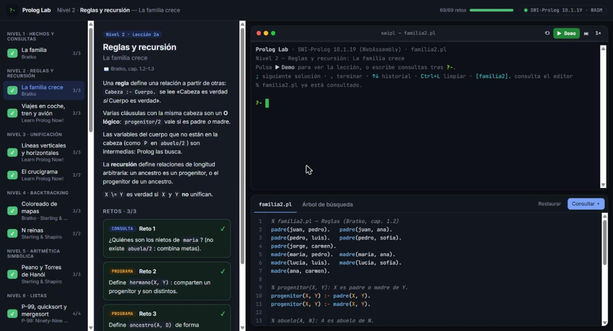
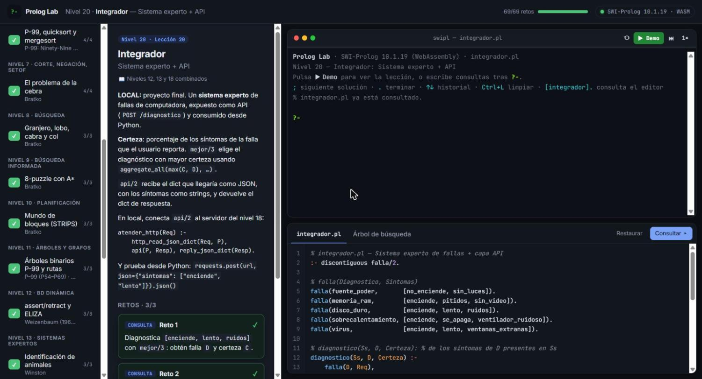
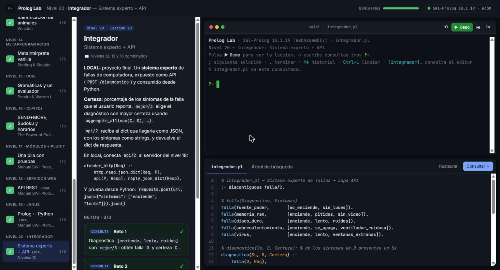
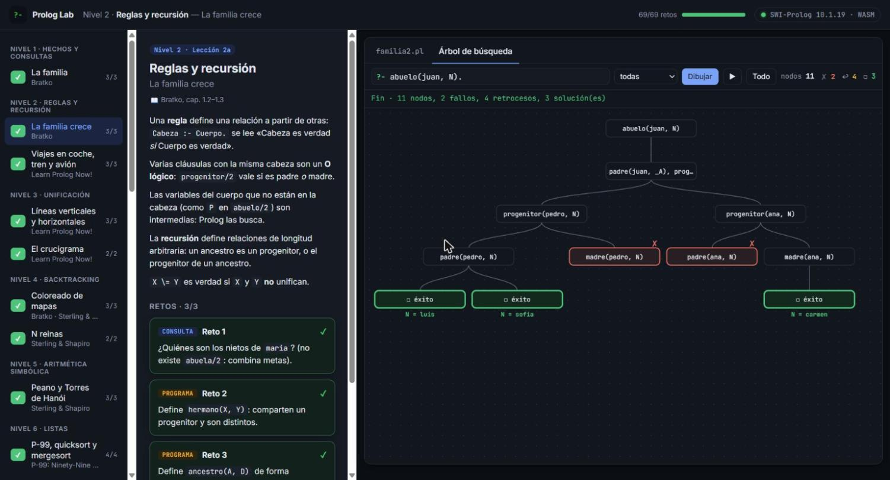
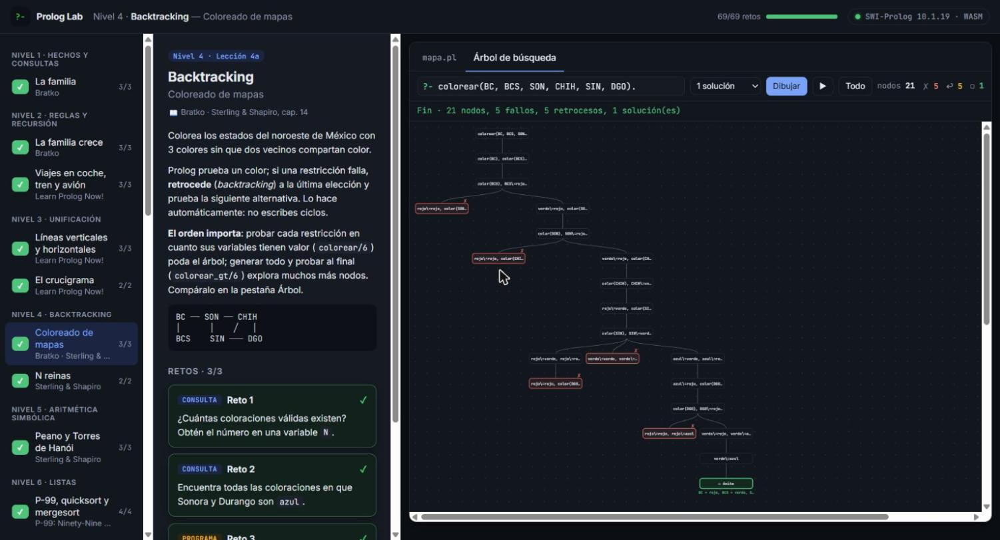
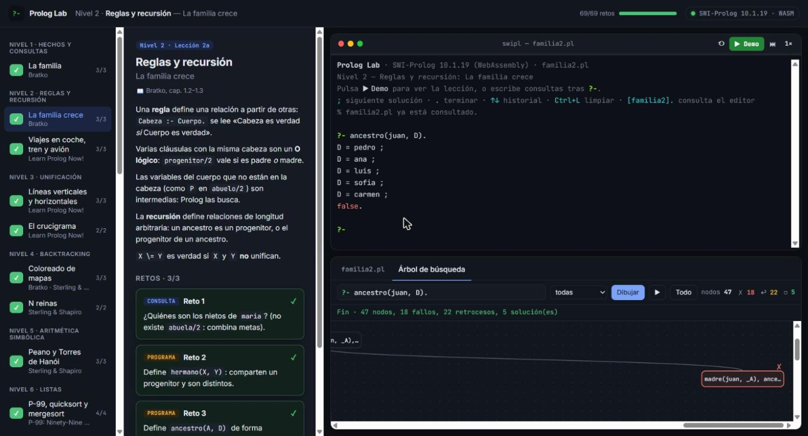

# Práctica 3.0 / 3.2 — Prolog Lab y mi Gemelo Digital (Farmacia #42)

**Hugo Iram Aguirre Dávila** · ISC · TecNM Tijuana · Programación Lógica y Funcional (26b, 4A)
Profesor: René Solís Reyes · Tutorial: <https://prolog-lab.fly.dev>

| Entregable que pide la práctica | Dónde está |
|---|---|
| Capturas del menú con los niveles completados (✓) | [`capturas/01`](capturas/01-menu-niveles-1-a-6-69de69.jpg) · [`02`](capturas/02-menu-niveles-6-a-13.jpg) · [`03`](capturas/03-menu-niveles-13-a-20.jpg) — **69/69 retos, 20/20 niveles** |
| Uso del árbol de búsqueda / backtracking | [`capturas/04`](capturas/04-arbol-busqueda-abuelo.jpg) · [`05`](capturas/05-arbol-backtracking-mapa.jpg) · [`06`](capturas/06-terminal-ancestro-backtracking.jpg) |
| Base de conocimiento del gemelo: ≥ 10 hechos, ≥ 3 reglas, ≥ 3 consultas | [`gemelo_farmacia_minimo.pl`](gemelo_farmacia_minimo.pl): 21 hechos, 7 reglas, 1 DCG, 7 consultas |
| Consultas con sus respuestas | [`consultas_y_respuestas.md`](consultas_y_respuestas.md) · salida real: [`salida_demo.txt`](salida_demo.txt) |
| Evidencia de los retos resueltos | [`prolog_lab_soluciones.pl`](prolog_lab_soluciones.pl): las 69 soluciones, nivel por nivel |
| Reflexión (media cuartilla) | [`reflexion.md`](reflexion.md) |

## Cómo reproducirlo

```bash
swipl gemelo_farmacia_minimo.pl
?- demo.                                   % corre las 7 consultas y la del assert
?- decide(luis, ibuprofeno_400, D, Por).   % o cualquier consulta suelta
```

Probado con SWI-Prolog 11.0.1 (Windows) y compatible con SWI-Prolog 9.x de Ubuntu/WSL/EC2.

## Niveles del Lab que usa el gemelo

| Nivel | Concepto | En el gemelo de la farmacia |
|---|---|---|
| 1–2 | Hechos y reglas | `medicamento/3`, `alergia/2`, `alergico/2` (nombre comercial → principio → alergia) |
| 7 | Negación, `setof` | `lote_apto/3` con `\+ lote_retirado/2`; `setof` de lotes aptos |
| 11 | Grafos / relaciones | cadena `lote_retirado → venta → paciente` en `por_avisar/2` |
| 12 | BD dinámica | `registrar_surtido/2` con `assertz`: el gemelo aprende |
| 13 | Sistema experto | `decide/4` decide **y explica** con la lista de hechos que usó |
| 15 | DCG | `pregunta//2`: «¿le surto amoxil_500 a ana?» |
| 18–20 | API, Janus, integrador | en el proyecto final: [`../gemelo/`](../gemelo/) (servidor web en Prolog + Python vía Janus) |

## Capturas

**Menú: 69/69 retos y los 20 niveles con ✓**





**Árbol de búsqueda: éxitos (□), fallos (✗) y retrocesos**




